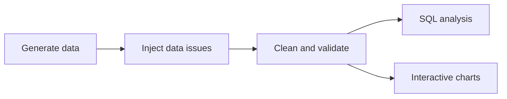
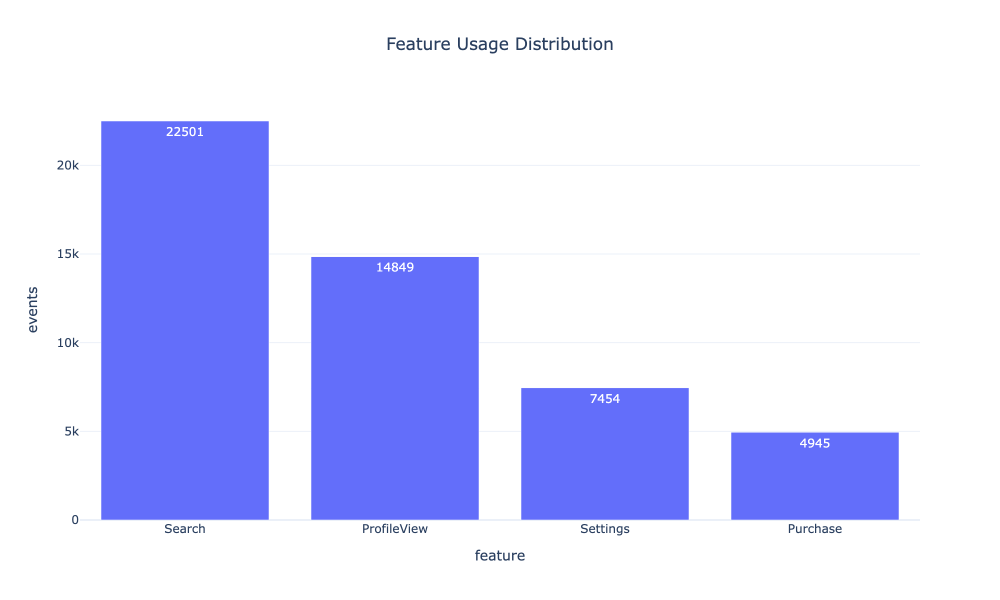
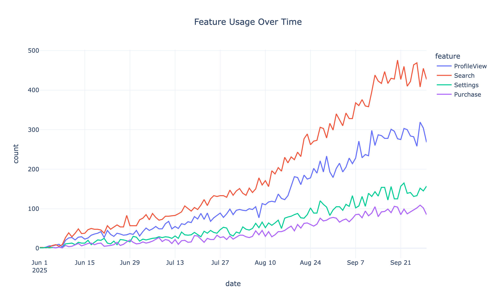

<h1 align="center">📊 User Insights Dashboard</h1>

<p align="center">
  <em>From messy product data to clear answers: what users do, how engaged they are, and where the revenue comes from.</em>
</p>

<p align="center">
  
  
  
  
</p>

> **Note:** All data in this project is simulated. The goal is to demonstrate methodology (data generation, cleaning, validation, and analysis), not to describe real user behavior.

---

## ✨ Overview

This is an end-to-end analytics project. It generates a realistic product dataset, deliberately breaks it the way real data breaks, cleans and validates it, and then turns it into interactive charts that explain **feature usage, engagement, and revenue**.



## 🔍 What It Does

| Step | Description |
|------|-------------|
| **Generate** | Builds three related tables (`users`, `events`, `purchases`) with realistic patterns, such as a small group of power users driving most activity. |
| **Break** | Injects common real-world problems on purpose: duplicate rows, missing values, inconsistent labels, and orphan user IDs. |
| **Clean** | Fixes and validates the data, reporting exactly what was removed or excluded and why. |
| **Visualize** | Produces interactive Plotly charts you can hover, filter, and explore. |
| **Analyze** | Uses SQL (DuckDB) to compute DAU, week-over-week growth, cohort retention, and revenue per user. |

## 🧹 Data Quality Results

| Check | Result |
|-------|-------:|
| Raw events | 50,500 |
| Events after removing duplicates and orphan user IDs | 49,749 |
| Missing session durations (excluded from duration chart) | 995 |
| Missing purchase amounts (excluded from revenue) | 100 |

## 📈 Charts

<p align="center">
  
  
</p>

> Interactive versions of every chart are saved in the [`visuals/`](visuals/) folder.

## 💡 Key Findings

1. **[Feature]** is the most-used feature, accounting for about **X%** of all events.
2. A small share of users (**Y%**) generate most of all actions.
3. **[Plan type]** users generate the most revenue per user.
4. **[Optional: a retention or growth insight from your SQL results]**

## 🛠️ Tech Stack

- **Language:** Python 3
- **Data:** Pandas, NumPy
- **Visualization:** Plotly
- **SQL:** DuckDB

## 📁 Project Structure

```text
user-insights-dashboard/
├── data/                         # Generated CSVs (users, events, purchases)
├── visuals/                      # Saved interactive charts
├── generate_user_behavior.py     # Creates the simulated dataset
├── user_insights_dashboard.py    # Cleans data and builds charts
├── sql_analysis.py               # SQL metrics with DuckDB
└── requirements.txt
```

## 🚀 How to Run

```bash
# Clone the repo
git clone https://github.com/kbhurtyal/user-insights-dashboard.git
cd user-insights-dashboard

# Set up the environment
python3 -m venv venv
source venv/bin/activate
pip install -r requirements.txt

# Generate the data, then clean it and build the charts
python3 generate_user_behavior.py
python3 user_insights_dashboard.py
```

## 🔮 Possible Next Steps

- [ ] Add automated data validation checks with Great Expectations
- [ ] Build an interactive Streamlit version with filters
- [ ] Simulate and analyze an A/B test

---

<p align="center">Built by <a href="https://github.com/kbhurtyal">@kbhurtyal</a></p>